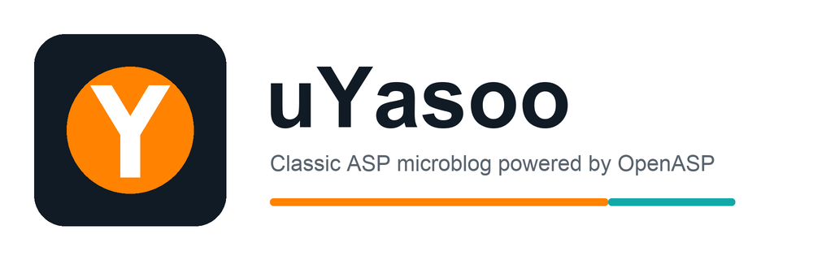
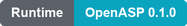

# uYasoo: ASP MicroBlog

<p align="center" id="uyasoo-top">
  
</p>
<p align="center">
  <a href="https://github.com/asp-lang/openasp"></a>
  <a href="https://spdx.org/licenses/MIT.html"></a>
  <a href="#requirements"></a>
  <a href="#requirements"></a>
</p>
<p align="center">
  <a href="https://uyasoo.com">Demo</a> |
  <a href="#architecture">Architecture</a> |
  <a href="#requirements">Requirements</a> |
  <a href="#1-install-system-dependencies">Install</a> |
  <a href="#4-start-the-application">Start</a> |
  <a href="https://asp-lang.org">OpenASP</a> |
  <a href="README.zh-CN.md">简体中文</a>
</p>

An online demo is available at [https://uyasoo.com](https://uyasoo.com).

uYasoo is a complete Classic ASP microblog built for [OpenASP](https://github.com/asp-lang/openasp). It uses Redis for application data, sessions, remember-me tokens, and image caching, and runs behind Nginx through `openasp-fpm`.

The application includes registration and sign-in, profiles, follows, personal timelines, topics, posts, comments, likes, search, image uploads, bot settings, AJAX updates, pagination, and a no-JavaScript form fallback.

## Architecture

```text
Browser -> Nginx :18081 -> FastCGI -> openasp-fpm :19000
                                      |
                                      +-> Redis :6379, database 9
                                      +-> assets/uploads/
                                      +-> .run/openasp-cache/
```

The bundled [`nginx.conf`](nginx.conf) is self-contained and uses the local [`nginx/mime.types`](nginx/mime.types) and [`nginx/fastcgi_params`](nginx/fastcgi_params) files. It does not depend on a Homebrew- or distribution-specific Nginx configuration directory.

## Requirements

| Dependency | Purpose |
| --- | --- |
| OpenASP 0.1.0 full build | Classic ASP runtime, FastCGI, Redis, Crypto, stream, and filesystem components |
| Redis | Application storage; defaults to database `9` |
| Nginx | Static files and FastCGI reverse proxy |
| `curl` | Startup verification |
| Python 3 | Optional repository tooling |

This project requires the **full** OpenASP profile because it uses `OpenASP.Redis`, `OpenASP.Crypto`, `ADODB.Stream`, and `Scripting.FileSystemObject`. Do not use `make minimal`.

OpenASP 0.1.0 provides official binary archives for:

- Linux x86-64
- MacOS Apple Silicon

Other systems must build OpenASP from source.

## 1. Install System Dependencies

### MacOS

Install the Xcode command-line tools and Homebrew packages:

```sh
xcode-select --install
brew install nginx redis pkg-config pcre2 libxml2 curl sqlite json-c openssl@3 \
    mariadb-connector-c mdbtools
brew services start redis
```

If the Xcode tools are already installed, `xcode-select --install` reports that
no installation is necessary.

### Ubuntu 24.04

```sh
sudo apt-get update
sudo apt-get install -y \
    nginx redis-server python3 curl git \
    build-essential pkg-config \
    libpcre2-dev libxml2-dev libcurl4-openssl-dev libsqlite3-dev \
    libjson-c-dev libssl-dev libmariadb-dev mdbtools-dev \
    libglib2.0-dev gettext
sudo systemctl enable --now redis-server
```

Verify Redis:

```sh
redis-cli ping
```

The expected response is `PONG`.

## 2. Install OpenASP

For more information about OpenASP, visit its official website: [https://asp-lang.org](https://asp-lang.org).

### Option A: build the full runtime from source

This is the most portable installation method and ensures that OpenASP links against the libraries installed on the current machine:

```sh
git clone --depth 1 https://github.com/asp-lang/openasp.git
cd openasp
make clean
make all
make test
export OPENASP_HOME="$PWD"
export PATH="$OPENASP_HOME/build/bin:$PATH"
```

`make all` writes these programs to `build/bin/`:

- `openasp`
- `openasp-fpm`
- `openasp-cli`
- `openasp-dis`
- `openasp-dbg`

Add the `PATH` export to the shell profile if it must persist across terminals.

### Option B: use the official 0.1.0 release

The release files are published on the [OpenASP Releases page](https://github.com/asp-lang/openasp/releases/tag/v-0.1.0).

Linux x86-64:

```sh
mkdir -p "$HOME/.local/opt"
curl -fL \
    https://github.com/asp-lang/openasp/releases/download/v-0.1.0/openasp-0.1.0-linux-x86-64.tar.gz \
    -o /tmp/openasp-0.1.0-linux-x86-64.tar.gz
tar -xzf /tmp/openasp-0.1.0-linux-x86-64.tar.gz -C "$HOME/.local/opt"
export PATH="$HOME/.local/opt/openasp-0.1.0-linux-x86-64/bin:$PATH"
```

MacOS Apple Silicon:

```sh
mkdir -p "$HOME/.local/opt"
curl -fL \
    https://github.com/asp-lang/openasp/releases/download/v-0.1.0/openasp-0.1.0-macos-arm64.zip \
    -o /tmp/openasp-0.1.0-macos-arm64.zip
unzip -q /tmp/openasp-0.1.0-macos-arm64.zip -d "$HOME/.local/opt"
export PATH="$HOME/.local/opt/openasp-0.1.0-macos-arm64/bin:$PATH"
```

Verify either installation:

```sh
openasp --help
openasp-fpm --help
```

If a release binary reports a missing shared library, install the dependency named by the loader or use the source-build method above.

## 3. Prepare the Application

Run all remaining commands from the `uyasoo-microblog` directory:

```sh
cd uyasoo-microblog
mkdir -p .run/openasp-cache assets/uploads
chmod u+rwx .run .run/openasp-cache assets/uploads
redis-cli -n 9 ping
nginx -t -p "$PWD/" -c nginx.conf
```

Both checks must succeed before continuing.

The default application settings are in [`config.asp`](config.asp):

| Setting | Default | Meaning |
| --- | --- | --- |
| `REDIS_CONNECTION` | loopback, port `6379`, database `9` | Redis connection |
| `REDIS_PREFIX` | `openasp:microblog:` | Namespace for application keys |
| `FEED_PAGE_SIZE` | `10` | Posts loaded per page |
| `MAX_AVATAR_BYTES` | `1 MiB` | Avatar upload limit |
| `MAX_POST_IMAGE_BYTES` | `5 MiB` | Post image upload limit |

If Redis requires authentication or a different endpoint, update `REDIS_CONNECTION`. OpenASP accepts connection strings containing `Host`, `Port`, `Username`, `Password`, `Database`, and `Timeout`.

## 4. Start the Application

### Terminal 1: OpenASP FastCGI

From the application directory:

```sh
openasp-fpm \
    --root "$PWD" \
    --host 127.0.0.1 \
    --port 19000 \
    --workers 2 \
    --max-requests 10000 \
    --memory-limit 128M \
    --opcache-memory 64 \
    --opcache-dir "$PWD/.run/openasp-cache" \
    --opcache-validate-timestamps=on \
    --log-file stderr \
    --log-level info \
    --shell-enable=off \
    --process-enable=off
```

Keep this terminal open. A successful startup reports that FastCGI is listening on `127.0.0.1:19000`.

The opcache directory is also used by OpenASP for persistent Session and
Application state, so it must remain writable by the FPM account.

### Terminal 2: Nginx

```sh
cd uyasoo-microblog
nginx -p "$PWD/" -c nginx.conf
```

Open <http://127.0.0.1:18081/> in a browser.

## 5. Verify the Deployment

```sh
curl -fsS http://127.0.0.1:18081/ >/dev/null
curl -I http://127.0.0.1:18081/assets/app.css
redis-cli -n 9 ping
```

Expected results:

- the first command exits with status `0`;
- the CSS request returns `HTTP/1.1 200 OK`;
- Redis returns `PONG`.

Create two accounts in the browser and verify posting, following, comments, and image uploads to exercise the complete data path.

The repository's historical `tests/test_microblog.py` uses an older standalone OpenASP test-runner protocol. It is not the deployment entry point for OpenASP 0.1.0. Use the FastCGI and HTTP checks above for this release.

## Stop the Application

Stop Nginx from the application directory:

```sh
nginx -p "$PWD/" -c nginx.conf -s stop
```

Stop `openasp-fpm` with `Ctrl+C` in Terminal 1.

## Data and Runtime Files

| Path or keyspace | Contents |
| --- | --- |
| Redis database `9` | Users, posts, relationships, tokens, and image cache |
| `assets/uploads/` | Uploaded image files |
| `.run/openasp-cache/` | OpenASP bytecode cache and persistent ASP state |
| `.run/uyasoo-microblog-nginx-*.log` | Local Nginx logs |

To reset local development data, stop both services first, then run:

```sh
redis-cli -n 9 FLUSHDB
rm -rf .run/openasp-cache
find assets/uploads -type f ! -name .gitignore -delete
mkdir -p .run/openasp-cache
```

`FLUSHDB` permanently deletes every key in Redis database `9`. Do not run it if that database is shared with another application.

## Troubleshooting

### `openasp-fpm: command not found`

Confirm that the full OpenASP binary directory is on `PATH`:

```sh
command -v openasp-fpm
openasp-fpm --help
```

For a source build, the executable is `build/bin/openasp-fpm` inside the OpenASP repository.

### Nginx reports `502 Bad Gateway`

The FastCGI process is not reachable. Check Terminal 1 and confirm the port:

```sh
lsof -nP -iTCP:19000 -sTCP:LISTEN
```

On Linux, use `ss -ltnp | grep 19000` if `lsof` is unavailable.

### Redis connection errors

```sh
redis-cli -h 127.0.0.1 -p 6379 -n 9 ping
```

Check that [`config.asp`](config.asp) uses the same host, port, credentials, and database.

### Uploads fail

Ensure the FPM account can write to both runtime directories:

```sh
test -w assets/uploads
test -w .run/openasp-cache
```

Nginx limits the complete request body to `6 MiB`; the application separately limits avatars to `1 MiB` and post images to `5 MiB`.

### Nginx fails to start

```sh
nginx -t -p "$PWD/" -c nginx.conf
cat .run/uyasoo-microblog-nginx-error.log
```

Check that ports `18081` and `19000` are not already in use.

## Production Notes

The bundled configuration is intended for loopback development. For production:

- run Nginx and `openasp-fpm` as unprivileged service accounts;
- keep FastCGI on loopback or use an OpenASP Unix socket;
- give write access only to uploads, state, cache, and log directories;
- supervise `openasp-fpm` with systemd, launchd, or another service manager;
- terminate TLS at Nginx and set the public host name explicitly;
- keep `shell-enable` and `process-enable` off;
- keep timestamp validation on during development; in immutable deployments it
  may be disabled if every deployment restarts all workers;
- do not commit Redis passwords, bot API keys, or other production secrets;
- back up Redis and `assets/uploads/` together.

The FPM `--root` and Nginx `root` must resolve to the same physical application directory.

## Security Behavior

- State-changing forms use Session-scoped CSRF tokens.
- Passwords use random salts and repeated SHA-256 for portability. Production deployments should provide a native password hash such as Argon2id or scrypt.
- Remember-me cookies contain random tokens; Redis stores only token hashes.
- User content is HTML-escaped before rendering.
- Uploads are limited by size and validated by file signature.
- Nginx blocks direct access to internal ASP includes, tests, and uploaded
  files. Images are served through the validated `image.asp` endpoint.
- External post links require `http://` or `https://` and use
  `noopener noreferrer`.
- OpenASP process and shell components remain disabled.

## OpenASP References

- [OpenASP repository](https://github.com/asp-lang/openasp)
- [OpenASP 0.1.0 release](https://github.com/asp-lang/openasp/releases/tag/v-0.1.0)
- [Official build instructions](https://github.com/asp-lang/openasp#build-from-source)
- [Official Nginx deployment guide](https://github.com/asp-lang/openasp#deploy-with-nginx)
